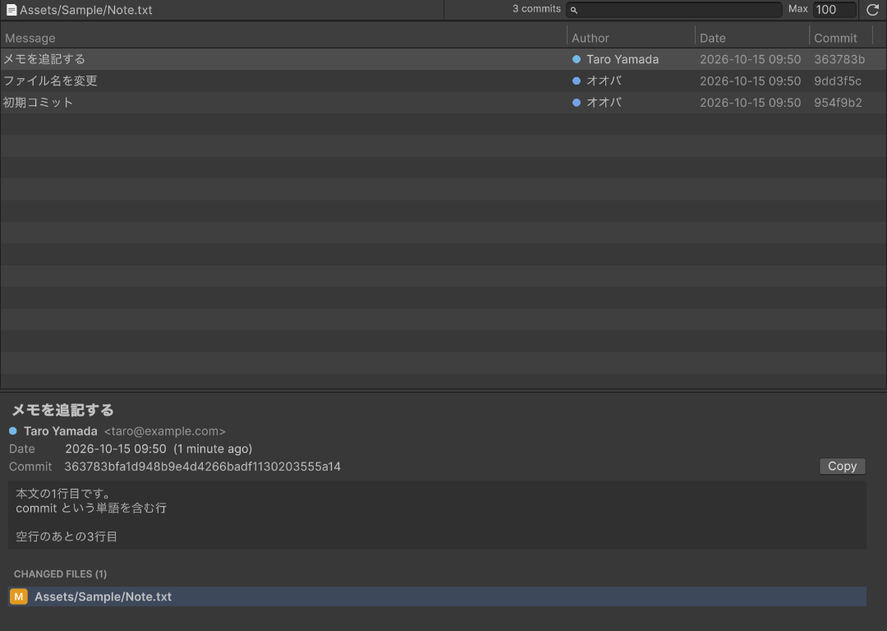

# UniGitHistoryViewer

UniGitHistoryViewer is an extension to view git logs in UnityEditor.

# Usage

Open the window from `Tools` -> `UniGitHistoryViewer`, or right-click an asset in the Project window and choose `Show Git History`.

The window follows the selection in the Project window. Click the lock icon on the tab to keep showing the current asset.

- Select a commit to see its full message, author, date, hash and the files it changed
- Click a changed file to highlight it in the Project window
- Filter commits by message, author or hash with the search field
- `Max` sets the maximum number of commits to load
- Copy the hash with the `Copy` button, `Cmd/Ctrl + C`, or the right-click menu
- Files keep their history across renames (`git log --follow`)
- Works with files in local (`file:`) packages as well as `Assets`

## Requirements

- `git` must be available on `PATH`
- Unity 2019.4 or later (tested with Unity 6000.3)

## UPM Package

### Install via git URL

After Unity 2019.3.4f1, Unity 2020.1a21, that support path query parameter of git package. You can add `https://github.com/baobao/UniGitHistoryViewer.git?path=Assets/UniGitHistoryViewer` to Package Manager

or add `"info.shibuya24.uni-git-history-viewer":"https://github.com/baobao/UniGitHistoryViewer.git?path=Assets/UniGitHistoryViewer"` to `Packages/manifest.json`.

## License

This library is under the MIT License.
